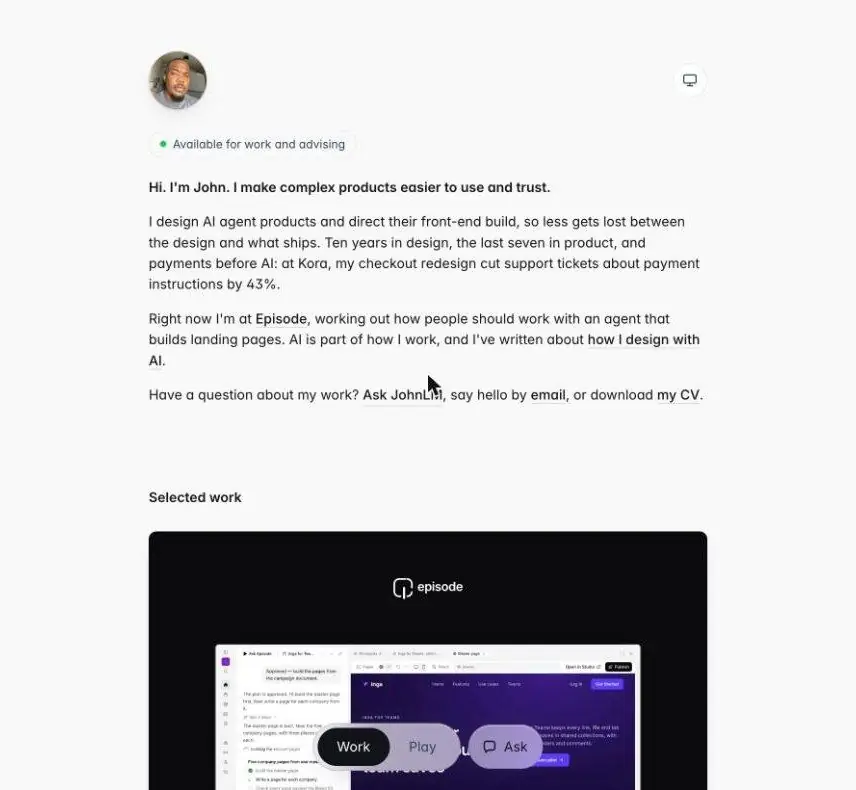
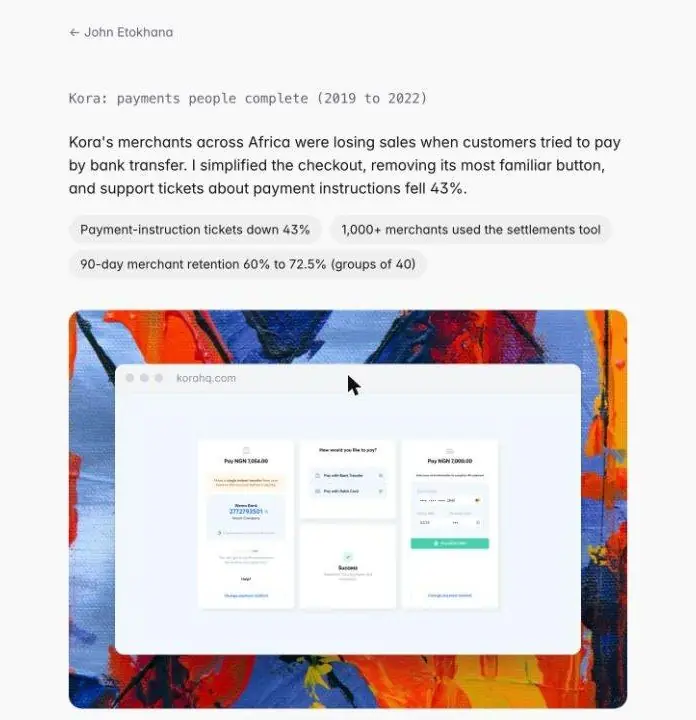
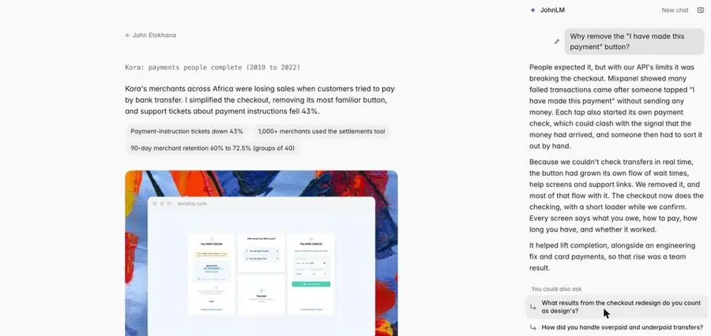
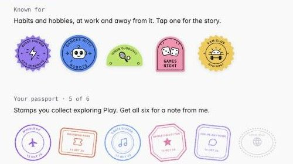

# johnetokhana.com

The code behind my portfolio. I'm John Etokhana, a product designer in London. I designed this site and directed its build with Claude Code, and it's where hiring teams read my case studies and ask questions about them.

**Live site:** [johnetokhana.com](https://johnetokhana.com)



## Why it's built this way

A portfolio gets read quickly, often by someone deciding whether to have a first conversation. That reader wants to see the real work, not just a summary of it, and they often have a follow-up question the page doesn't answer.

So every case study is a real piece of work you can read in a few minutes, and next to it sits JohnLM, a small chat that answers questions about my work in my own words.



## Key design decisions

**Results first, then the story.** Each case study opens with what changed and by how much, then explains how we got there. The pages are built from a small set of blocks (`src/components/cs/`): chapters, stats, before and after comparisons, figures and flow diagrams. That keeps every case study reading the same way, so a reviewer only has to learn the layout once.

**JohnLM only answers from what I've written.** Before each build, a script packs the site's case studies and a short set of rules into one prompt. JohnLM can't search the web, so it can only talk about what's actually on the site.



**It has to be honest about credit.** Some results in my work were team results, and some numbers belong to the product rather than to design. The test questions in `evals/johnlm/` check for exactly that. For example, JohnLM must never say design drove MilkyWay's $30M in staking, because that was the protocol's traction. It also refuses to share things like salary expectations or a phone number.

**Answers have a house style, and tests enforce it.** Every answer is checked for length (40 to 160 words), banned phrases ("Great question", "delve", "seamless"), em dashes, and two or three suggested follow-up questions at the end. The free checks run with the unit tests, so a change that breaks the style can't ship quietly.

**Motion is specified before it's built.** The `plans/` folder holds short specs for each animation, like how a card moves between two states or when a label fades. Writing the timing down first meant the build had exact numbers to follow, rather than tuning by eye after the fact.

**Real screens, fictional data.** Product screens in the case studies are the real apps running on made-up demo data, so nothing private appears on the site.

**Cost and privacy limits.** Each visitor gets 20 questions a day, with a ceiling for all visitors together. Questions and answers are logged for review, with no personal data beyond a hash that changes daily.

## Work and Play

The site has two modes. **Work** is the professional version: case studies, results and JohnLM. **Play** is the rest of me, because a portfolio should say something about the person, not only the job.

I like games, especially the daily ones like Wordle and LinkedIn's Zip, so Play is built a little like one. You explore it rather than read it. The stickers under "Known for" each open a short story about a habit or hobby. As you look around, you collect stamps in a passport, and finding all six unlocks a note from me. There's also what I've been listening to, straight from Spotify, and a photo from each of 23 places I've been.



Work always comes first. Someone short on time can stay in Work and never miss anything they need to hire me. Play is there for anyone who wants to know who they'd be working with.

## What's in the repo

| Path | What it holds |
| --- | --- |
| `src/pages/` | Home (Work and Play), the Play pages, and the case study route |
| `src/content/work/` | The case studies, written in MDX |
| `src/components/` | Page components; `cs/` holds the case study blocks |
| `src/scripts/` | Browser code: the JohnLM chat panel, the command menu, the dock, motion |
| `src/styles/global.css` | All styles and design tokens, light and dark |
| `src/data/site.ts` | The site's data: projects, places, music, links |
| `netlify/functions/ask.mjs` | JohnLM's server function |
| `netlify/functions/now-playing.mjs` | What I'm listening to, from Spotify |
| `evals/johnlm/` | Test questions for JohnLM and the checks its answers must pass |
| `plans/` | Motion specs |
| `tests/` | Unit tests |

## Run it

```sh
npm install
npm run dev      # the site on localhost
npm run gates    # type check, lint, tests and a full build
```

The functions need keys that are set in Netlify, not in this repo. In local dev, JohnLM's questions go to the live site's answer service (see `astro.config.mjs`), and the music page uses its saved list.

## About this copy

This is a public copy of the site's code for review. Two things differ from the private repo the site is built from:

- JohnLM's rules and fact file (`src/content/johnlm/system.md` and `facts.md`) are short examples. The live site uses fuller private versions.
- The list of names and numbers JohnLM must never say isn't included, so those checks run against placeholder terms.

## Built with

Astro, TypeScript and Netlify, with Claude for JohnLM's answers. I designed the site and directed the build with Claude Code, checking changes in the running site before they shipped.

Case studies, CV and contact: [johnetokhana.com](https://johnetokhana.com)
